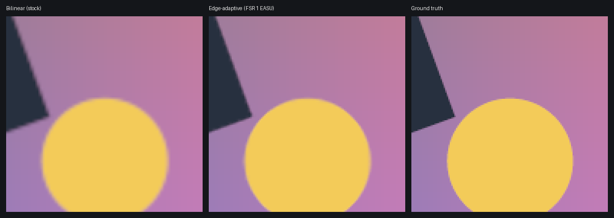

# Graphics quality settings

Optional image-quality upgrades in **Escape → GRAPHICS**, saved with the other display settings in
`settings/graphics.json`. Every default is the existing image: with nothing changed, the scene is
presented by the same `ImageNode`, no post-process pass is attached, and texture samplers are
unchanged. The code is `crates/skate-game/src/graphics_quality.rs` and
`graphics_present.wgsl`; nothing here touches the retail shaders or their parity.

| Row | Choices | What it does |
|---|---|---|
| Internal resolution | 25–100% (as before), **125%, 150%, 200%** | Above 100% the scene is supersampled: rendered larger and box-filtered down to the window in linear light. The best anti-aliasing available, at a GPU cost that scales with the pixel count (200% is 4× the pixels). The target is capped at 8192 px per side, the WebGPU limit, keeping the aspect. |
| Upscaling | Bilinear, Edge-adaptive (FSR 1) | Below 100% only. Bilinear is the old stretch. Edge-adaptive is AMD FidelityFX Super Resolution 1.0's EASU, ported to WGSL (MIT notice in the shader): direction-aware Lanczos-like reconstruction with deringing. |
| Sharpening | Off, 25–100% | AMD contrast-adaptive sharpening (Bevy's CAS) on the 3D camera, at render resolution, after anti-aliasing. |
| Anti-aliasing | Off, FXAA, SMAA, SMAA Ultra | Bevy's post-process passes on the 3D camera, after the retail tone pass. |
| Texture filtering | Trilinear, 2×–16× anisotropic | World texture pages. Applies the next time a map loads (MAPS → a map → Skate from default spawn reloads it). |
| Texture pack | Off, each folder in `texture-packs` | Your own replacement textures ([texture-packs.md](texture-packs.md)). World textures apply the next time a map loads, character textures at the next start. |

Upscaling below 100% with Edge-adaptive and some sharpening is the FSR 1 recipe for weak GPUs and the
browser build. CAS runs before the upscale here (FSR 1 proper runs RCAS after it), which keeps the
whole thing to one extra pass.

## What is not offered, and why

- **MSAA** stays off under the render-capacity policy (`render_capacity.rs`, RFC 1 D7). The
  post-process passes cost per pixel, not per draw, so they do not affect that contract.
- **TAA** needs per-pixel motion vectors. The retail world and character prepass shaders
  (`retail_depth.wgsl`, `retail_character_depth.wgsl`) write none, and the camera would need
  jittered projections. Adding both is a renderer change to the retail path; it is a follow-up,
  not an option that would smear moving skaters today.
- **HD textures** come from a texture-pack loader (planned): the engine will load replacement
  textures that players make or obtain themselves. No upscaled EA data is shipped.

## Ordering

The retail tone pass (`retail_exposure.rs`) is a node between Bevy's `Tonemapping` and
`EndMainPassPostProcessing`, and so are FXAA, SMAA and CAS, so their relative order was
unspecified. The tone pass now orders itself before FXAA and SMAA, and SMAA before CAS: anti-aliasing
sees the toned image and sharpening comes last. These are graph edges only; with every option off
the image is unchanged.

## Verification

`cargo test -p skate-game --bin skate3rust graphics_` covers the settings (old files load, invalid values
fall back, rows cycle, the target cap) and validates the shader with Naga without optional
capabilities, as WebGPU has. With a Vulkan adapter (Mesa's lavapipe is enough):

```
cargo test -p skate-game --bin skate3rust graphics_quality -- --ignored --nocapture
```

renders the shader through wgpu and checks the following. Results are from lavapipe (Mesa 25 software
Vulkan):

| Check | Result |
|---|---|
| 200% resolve against a CPU 2×2 box filter in linear light | within 1 code value everywhere |
| 150% resolve against the true downscale of an edge-rich scene | 41.05 dB PSNR |
| Edge-adaptive 2× upscale of that scene from half resolution | **34.42 dB**, against 29.60 dB for the stock bilinear stretch |
| A flat colour through the edge-adaptive path at 2×, 1.5× and 2.43× | unchanged (±1) |
| End to end in Bevy: the retail tone node with SMAA Ultra, then FXAA, plus CAS, the new graph edges, a flat image through `PresentMaterial` in both modes, a 16× anisotropic page sampler | renders without a wgpu validation error, edges present, both modes flat |

Set `SKATE_PRESENT_DUMP=DIR` to keep the upscale test's images. A crop, 3× zoomed:



Not verified here: the look in a real retail map. That needs a converted installation, so check
the options in-game on Windows.
